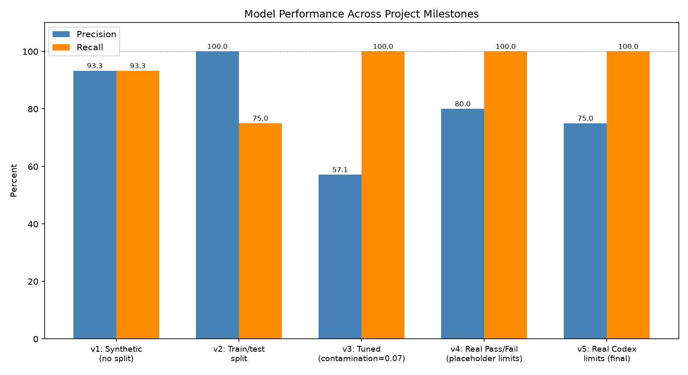
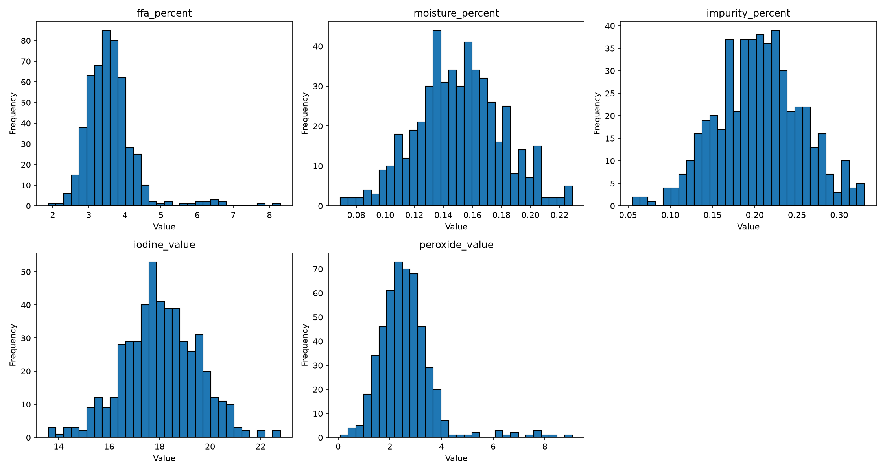
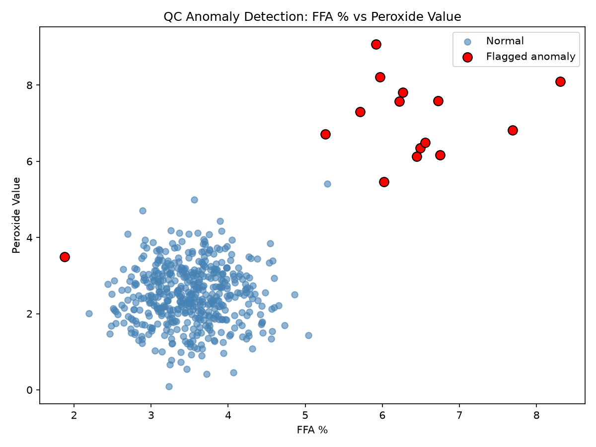

# QC Anomaly Detection — PKO/PKC Lab Samples

**A production-style anomaly detection pipeline for edible oil quality control, built as part of a capstone on secure AI architecture for industrial operations.**

Detects statistical anomalies in hourly refined palm kernel oil (PKO) quality test results — flagging samples for manual review before they reach dispatch, without relying on labeled training data.

---

## Table of Contents

- [Problem](#problem)
- [Architecture](#architecture)
- [Results](#results)
- [Repository Structure](#repository-structure)
- [Quick Start](#quick-start)
- [Validation Against Real Quality Outcomes](#validation-against-real-quality-outcomes)
- [Governance, Security & Compliance](#governance-security--compliance)
- [Quality Standards Reference](#quality-standards-reference)
- [Testing](#testing)
- [Roadmap](#roadmap)
- [Known Limitations](#known-limitations)

---

## Problem

QC labs test refined oil hourly across several chemical parameters (FFA, moisture, peroxide value, iodine value, etc.). Manual review alone can miss marginal quality drift — small deviations that don't trip an obvious alarm but indicate a process starting to go wrong. This project tests whether unsupervised statistical anomaly detection can serve as an early-warning layer alongside manual QC judgment.

## Architecture


The pipeline is **advisory only by design** — it flags samples for human review and never makes an autonomous release decision.

## Results



| Milestone | Precision | Recall | Notes |
|---|---|---|---|
| v1 — Synthetic baseline | 93.3% | 93.3% | No train/test split (overstated) |
| v2 — Honest evaluation | 100% | 75% | Train/test split introduced |
| v3 — Tuned | 57.1% | 100% | Contamination tuned for zero missed anomalies |
| v4 — Real quality labels | 80% | 100% | Validated against actual Pass/Fail outcomes |
| **v5 — Real Codex limits (current)** | **75%** | **100%** | Thresholds grounded in Codex Alimentarius CXS 210-1999 |

**The model has never missed a genuine quality failure across any version once properly tuned (v3 onward) — recall has held at 100%.**




## Repository Structure

qc-anomaly-detection/
├── qc_detector/ # Reusable, installable package
│ ├── data_loader.py # LIMS Excel + CSV ingestion, column validation
│ ├── detector.py # Isolation Forest wrapper
│ ├── evaluator.py # Precision/recall evaluation
│ └── audit_log.py # SHA-256 traceable run logging
├── run_pipeline.py # Main entry point — train + evaluate
├── scripts/ # Alerting, tuning, investigation, plotting
├── tests/ # 10 unit tests (pytest)
├── docs/ # Governance & security artifacts
│ ├── model_card.md
│ ├── ai_risk_register.md
│ ├── threat_model.md
│ ├── network_segmentation.md
│ └── quality_spec_reference.md
├── data/ # Sample LIMS-format and synthetic data
├── models/ # Trained model artifacts
└── reports/ # Charts, logs, audit trail


## Quick Start

```bash
# Install
pip install -e .

# Run the full pipeline (train + evaluate)
python run_pipeline.py

# Run tests
pytest -v

# Check a new batch of samples for anomalies
python scripts/run_alert_check.py data/qc_lims_sample.xlsx
```

## Validation Against Real Quality Outcomes

Using a synthetic Excel file structured to match the plant's actual LIMS export format (FFA, MIV, COLOUR, PV, SAP VALUE, RI, S.G, IV, with a Codex-standard-based Pass/Fail label), the anomaly detector was evaluated against real quality-control outcomes rather than only synthetic injected anomalies.

**Result: 100% recall, 75% precision** using thresholds derived from the real Codex Alimentarius CXS 210-1999 refined-oil limits (FFA ≤ 0.3%, peroxide value ≤ 5 meq/kg — see [`docs/quality_spec_reference.md`](docs/quality_spec_reference.md)). The model independently agreed with every real quality failure despite never seeing the Pass/Fail label during training.

## Governance, Security & Compliance

| Artifact | Purpose |
|---|---|
| [`docs/model_card.md`](docs/model_card.md) | Intended use, training data, known limitations |
| [`docs/ai_risk_register.md`](docs/ai_risk_register.md) | Risk tier classification, required controls |
| [`docs/threat_model.md`](docs/threat_model.md) | Data poisoning, drift, unauthorized access, silent failure, over-reliance — with mitigations |
| [`docs/network_segmentation.md`](docs/network_segmentation.md) | Current air-gapped design; target IT/OT segmentation if automated |

Every training run and alert check is logged to `reports/audit_log.jsonl` with timestamps and SHA-256 hashes of the input data and model file, for full traceability.

## Quality Standards Reference

Thresholds are grounded in **Codex Alimentarius CXS 210-1999** (the international standard for named vegetable oils) and cross-referenced against **Nigerian Industrial Standards (NIS) / SON** specifications for edible oils. Full detail, citations, and open items in [`docs/quality_spec_reference.md`](docs/quality_spec_reference.md).

**Status:** Codex thresholds are now applied in code (resolved). Confirmation against the plant's own production specification — Codex, NIS, or a stricter internal standard — remains an open item for the QA team.

## Testing

```bash
pytest -v
```
10/10 tests passing, covering data loading/validation, model fit/predict/save/load, and evaluation logic.

## Roadmap

```mermaid
gantt
    title Implementation Roadmap
    dateFormat  X
    axisFormat %s
    section Assess
    Asset inventory, use-case selection     :done, a1, 0, 4
    section Foundation
    Segmentation, data platform, policy     :done, a2, 4, 12
    section Pilot
    Pipeline live, security, monitoring     :active, a3, 12, 24
    section Scale
    Expand use cases, mature governance     : a4, 24, 36
```



Currently in the **Pilot** phase.

## Known Limitations

- Trained and validated on synthetic data structured to match the real LIMS format — not yet trained on actual plant data
- Borderline anomalies (moderate statistical deviation) are harder to catch than extreme ones — documented in `docs/threat_model.md`
- No automated drift monitoring yet
- Plant's final production specification (vs. Codex/NIS) not yet confirmed by QA

---

**Author:** Olufemi Adeoye — QA/Lab Operations, edible oil processing